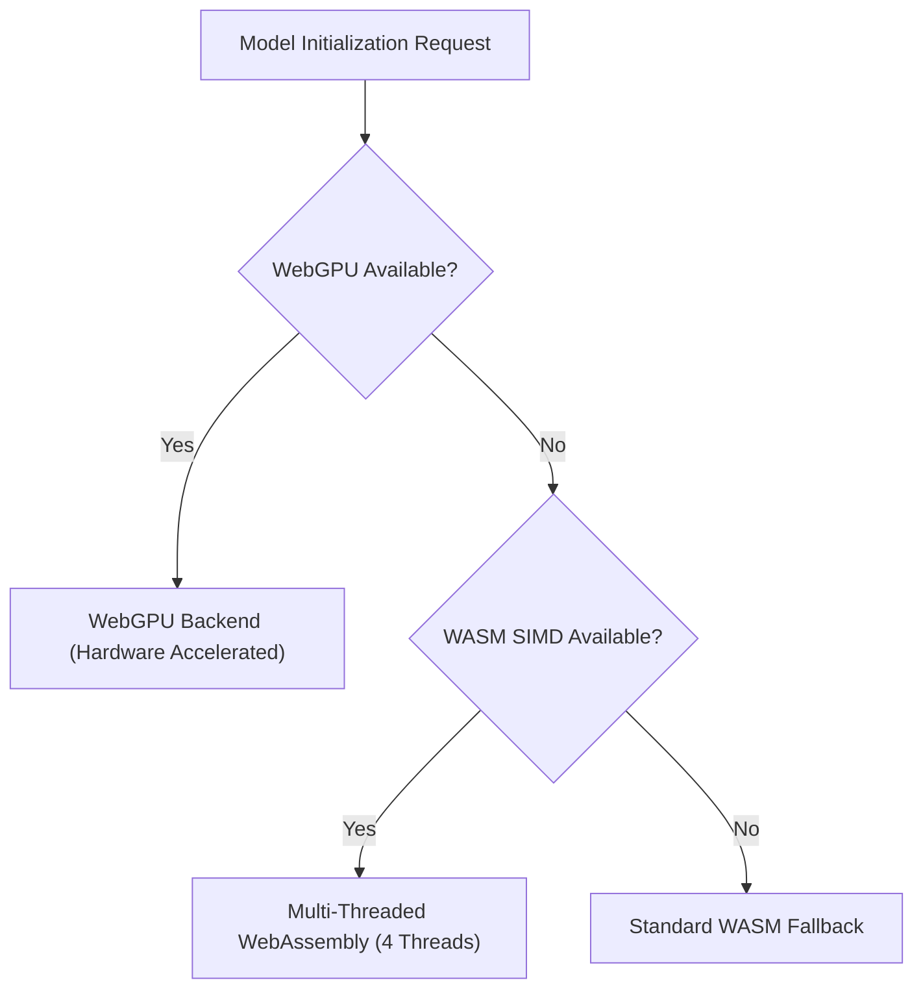

# AI ExamGuard — Machine Learning Model Registry

This registry records every on-device computer vision and audio model integrated into AI ExamGuard, their underlying architectures, licenses, precision, input dimensions, and verified execution providers.

---

## 1. Registered Models

| Model Name | Framework / Engine | Weights File | License | Input Shape | Purpose |
|---|---|---|---|---|---|
| **MediaPipe FaceLandmarker** | `@mediapipe/tasks-vision` | `face_landmarker.task` | Apache 2.0 | $256 \times 256 \times 3$ RGB | 478 3D facial landmarks, iris pupil tracking, 3D yaw/pitch/roll |
| **MediaPipe EfficientDet-Lite0** | `@mediapipe/tasks-vision` | `efficientdet_lite0.tflite` | Apache 2.0 | $320 \times 320 \times 3$ RGB | Mobile phone, secondary laptop, tablet, additional person, book |
| **ONNX Runtime YOLOv8 Detector** | `onnxruntime-web` | `yolo_exam_guard_quant.onnx` | AGPL-3.0 / Commercial | $640 \times 640 \times 3$ Float32 | Multi-object examination room security verification |
| **Speech Band Spectral VAD** | Web Audio API / FFT | Native Engine | MIT | $100\text{ms}$ Float32 @ 16kHz | Speech-band energy concentration ($300\text{Hz} - 3,400\text{Hz}$) vs broad noise |

---

## 2. Hardware Acceleration & Fallback Hierarchy

---

## 3. Threshold Calibration Matrix

- **Phone Detection Score:** $\ge 0.45$
- **Phone Sustained Persistence:** $\ge 1,800\text{ms}$ consecutive appearance
- **Additional Person Count:** $\ge 2$ sustained for $\ge 2,500\text{ms}$
- **Gaze Deviation Yaw:** $\pm 22.0^\circ$ relative to calibrated neutral baseline
- **Speech Band Ratio:** $\ge 0.58$ acoustic energy in $300\text{Hz} - 3.4\text{kHz}$ band for $\ge 2,500\text{ms}$

