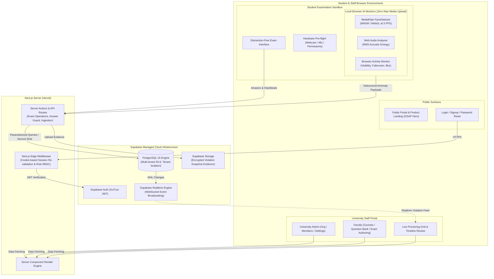

# AI ExamGuard — System Architecture Specification

## 1. Executive Summary & Product Vision

**AI ExamGuard** is an institutional-grade, AI-assisted online examination integrity and proctoring platform designed for higher education universities and credentialing bodies. It enables faculty to author, schedule, and administer secure online examinations, allows students to take exams in an accessible, distraction-free environment, and empowers human invigilators with real-time, explainable AI risk indicators.

The platform operates on a **Human-in-the-Loop** philosophy:
- AI **never** automatically disqualifies or fails a student.
- AI processes webcam video and microphone audio **entirely locally in the browser** to detect specific objective signals (face presence, multiple faces, sustained acoustic anomalies, fullscreen exits, tab switching).
- High-confidence anomaly events are ingested, enriched with context and risk weights, and streamed in real time to authorized invigilators.
- Invigilators and faculty retain final judgment through an auditable, timestamped evidence review timeline.

---

## 2. Fixed Technology Stack Analysis & Compatibility Review

| Layer / Library | Selected Version | Role & Architectural Compatibility Analysis |
|---|---|---|
| **Framework** | Next.js 16.4.6 (App Router) | React Server Components (RSC), Turbopack bundler, Partial Prerendering (PPR), Server Actions. Requires `cookies()` to be awaited. Dynamic route parameters must be awaited. |
| **Runtime / UI** | React 19.3.0 & React DOM 19.3.0 | Modern concurrent React primitives. Compatible with Base UI primitives and Framer Motion v14 (`motion/react`). |
| **Language** | TypeScript 5 (Strict Mode) | Strict type checking enabled (`noImplicitAny`, `strictNullChecks`). End-to-end type safety between database schemas, server actions, and client UI. |
| **Styling** | Tailwind CSS 4.3.3 | CSS-first configuration via `@import "tailwindcss"` and `@theme inline` in `globals.css`. Design tokens mapped to CSS custom properties. |
| **Component Primitives** | shadcn/ui (base-nova) & @base-ui/react | Unstyled, accessible UI primitives with Class Variance Authority (`cva`) styling. |
| **Backend & Database** | Supabase PostgreSQL | Multi-tenant relational schema with Row-Level Security (RLS) enforcement, foreign key constraints, and performance indexes. |
| **Authentication** | Supabase Auth (via `@supabase/ssr` 0.12.7) | Secure cookie-based authentication with Next.js Middleware session refreshing and server-side JWT verification using `getUser()`. |
| **Realtime Engine** | Supabase Realtime | WebSocket-powered PostgreSQL changes (`supabase_realtime` publication) streaming violation events to live invigilator dashboards. |
| **Vision AI** | `@mediapipe/tasks-vision` 1.2.2 | Google MediaPipe `FaceDetector` running locally in WebAssembly (WASM) and WebGL/GPU delegate. Throttled to 5 FPS to preserve student CPU/GPU headroom. |
| **Audio Processing** | Web Audio API (`AudioContext`, `AnalyserNode`) | In-browser RMS acoustic energy detection without uploading or retaining continuous raw audio streams. |
| **Orchestrated Animations** | GSAP 3.15.1 & `@gsap/react` 2.1.2 | High-performance timeline animations for hero landing sequences, scroll reveals, and statistical visualizations. Compatible with `prefers-reduced-motion`. |
| **UI Micro-Interactions** | Motion 14.12.0 (`motion`) | Component entry/exit transitions, layout morphing, modal dialogs, and toast notifications. |
| **Analytics & Data Viz** | Recharts 3.10.1 | Responsive charts for exam completion rates, trust score distributions, and temporal violation densities. |
| **Validation** | Zod 4.6.7 & React Hook Form 7.91.0 | Server-and-client isomorphic schema validation for exam authoring, question banks, and answer submissions. |
| **Icons** | Lucide React 1.71.0 | Consistent iconography for cybersecurity, proctoring metrics, and system statuses. |
| **Deployment** | Vercel | Edge CDN, Next.js optimized serverless functions, automatic preview deployments, and environment variable synchronization. |

---

## 3. High-Level Architecture Diagram



---

## 4. Subsystem Decomposition

### 4.1. Public Product Website Subsystem
- **Purpose**: Present institutional value proposition, compliance posture (FERPA/GDPR/SOC2), architecture whitepapers, and interactive feature breakdowns.
- **Tech**: Server components, GSAP timeline animations for hero cybersecurity aesthetics, Motion for responsive mobile navigation.

### 4.2. Identity, Multi-Tenancy & Access Control (RBAC) Subsystem
- **Purpose**: University tenant isolation and role assignment across four actors:
  1. `admin`: Full organizational management, faculty/invigilator onboarding, global exam audit logs.
  2. `faculty`: Course authoring, question bank curation, exam generation, grading, and post-exam integrity reports.
  3. `student`: Enrolled course access, pre-flight hardware verification, secure timed exam taking, and grade viewing.
  4. `invigilator`: Real-time session monitoring, candidate warning generation, live violation timeline triage, session pause/termination.
- **Security Mechanism**: Supabase Auth sessions stored in HTTP-only, secure, partitioned cookies. Middleware re-validates JWTs server-side using `supabase.auth.getUser()`. Role memberships queried via `university_members` table protected by RLS.

### 4.3. Examination Engine Subsystem
- **Purpose**: Comprehensive exam authoring and lifecycle management.
- **Lifecycle States**: `draft` → `published` → `scheduled` → `active` → `completed` → `archived`.
- **Question Types**: Multiple Choice Questions (MCQ with single/multiple correct answers), True/False, Short Answer, and Long-form Essay questions.
- **Security & Answer-Key Protection**: The server **never** delivers correct answer flags or grading keys to client browsers during an active exam. Submissions are graded server-side upon exam completion.

### 4.4. Student In-Browser AI Integrity Subsystem
- **Local Face Detection**: MediaPipe FaceDetector running as a WebAssembly module with GPU acceleration. Identifies:
  - `NO_FACE_DETECTED`: Student stepped away from view.
  - `MULTIPLE_FACES_DETECTED`: Unauthorized secondary person in camera view.
  - `FACE_OCCLUSION`: Face partially hidden or severely rotated away.
- **Local Audio Energy Detection**: Web Audio API `AnalyserNode` computes Root Mean Square (RMS) decibel levels to detect continuous talking or whispered speech without capturing or streaming raw acoustic recordings.
- **Browser State Sandboxing**: Listens to Page Visibility API (`visibilitychange`), Fullscreen API (`fullscreenchange`), Window Blur (`blur`), clipboard events (`copy`, `paste`), and context menu attempts (`contextmenu`).

### 4.5. Event Ingestion, Risk Engine & Realtime Dispatch Subsystem
- **Debounced Batching**: Client buffers anomaly events and flushes them to `/api/violations` every 3–5 seconds to prevent network saturation.
- **Trust Score Algorithm**: Each student session begins with a `trust_score` of 100.00. Violations incur severity-weighted penalties:
  - `LOW` (e.g., brief window blur < 2s): -2 points.
  - `MEDIUM` (e.g., tab switch, copy attempt): -5 points.
  - `HIGH` (e.g., no face detected > 5s, microphone speech detected): -12 points.
  - `CRITICAL` (e.g., multiple faces detected, persistent fullscreen exit): -25 points.
- **Realtime Broadcast**: Inserts into `violations` trigger Supabase Realtime broadcast channels subscribed to by active invigilators.

### 4.6. Invigilator Command Center Subsystem
- **Grid View**: Real-time tile view of all active candidates displaying candidate name, live webcam thumbnail, current trust score gauge, and active status pill.
- **Detail Modal & Timeline**: Interactive chronological timeline displaying every logged event with timestamp, confidence metric, and optional evidence snapshot.
- **Proctor Intervention Actions**: Send pop-up warning message to student, request camera re-alignment, or terminate session for flagrant misconduct.

---

## 5. Technical Boundary: Browser Sandbox vs. Native Desktop Application

To maintain absolute academic and technical honesty, the architectural boundary between what is achievable in a web browser versus what requires a future native desktop application is documented below:

| Integrity Check / Feature | Web Browser (AI ExamGuard MVP) | Native Application (Future Enterprise V2) |
|---|---|---|
| **Face Presence & Count** | ✅ **Full Support** via WebAssembly MediaPipe | ✅ Full Support |
| **Acoustic Volume Anomaly** | ✅ **Full Support** via Web Audio API | ✅ Full Support |
| **Tab / Window Switching** | ✅ **Full Support** via Page Visibility API | ✅ Full Support |
| **Fullscreen Exit Detection** | ✅ **Full Support** via HTML5 Fullscreen API | ✅ Full Support |
| **Clipboard / Context Menu** | ✅ **Full Support** (block copy/paste in window) | ✅ Full Support (system clipboard wiping) |
| **Prevent OS App Switching** | ❌ **Technically Impossible** (Browser cannot block OS shortcuts like Alt+Tab, WinKey) | ✅ **Full Support** (Native OS keyboard hooks) |
| **Dual / Secondary Monitor Blocking**| ❌ **Limited** (Screen details API requires explicit user permission; cannot disable HDMI) | ✅ **Full Support** (Hardware display enumeration & blanking) |
| **VM / Remote Desktop Detection** | ❌ **Technically Impossible** in standard Web APIs | ✅ **Full Support** (Driver / Hypervisor inspection) |
| **Screen Capture / Broadcast Interception**| ❌ **Technically Impossible** (Browser cannot inspect OBS/Discord processes) | ✅ **Full Support** (Process list scanning & blacklisting) |
| **Hardware Peripherals (Phone, Smartwatch)**| ⚠️ **Partial** (Detect secondary face or head turning only) | ⚠️ Partial (Requires secondary phone camera stream) |

---

## 6. Deployment & Infrastructure Architecture

```mermaid
flowchart LR
    subgraph VercelEdge["Vercel Global Edge Network"]
        CDN["Global Edge CDN\n(Static Assets, WASM bundles, fonts)"]
        Serverless["Edge & Serverless Node.js Functions\n(Next.js App Router, SSR, Server Actions)"]
    end

    subgraph SupabaseInfra["Supabase Cloud (AWS us-east-1)"]
        DB["PostgreSQL 15 Database (Dedicated Instance)"]
        Auth["Supabase Auth Engine"]
        Realtime["Realtime Elixir Cluster"]
        Storage["S3-compatible Encrypted Object Storage"]
    end

    subgraph ClientBrowsers["Client Endpoints"]
        Chrome["Google Chrome (Desktop)"]
        Edge["Microsoft Edge (Desktop)"]
        Firefox["Mozilla Firefox (Desktop)"]
    end

    ClientBrowsers -->|HTTPS / TLS 1.3| CDN
    ClientBrowsers -->|WSS / WebSocket| Realtime
    CDN --> Serverless
    Serverless -->|Connection Pooler (PgBouncer)| DB
    Serverless -->|REST / JWT| Auth
    Serverless -->|S3 API| Storage
```

