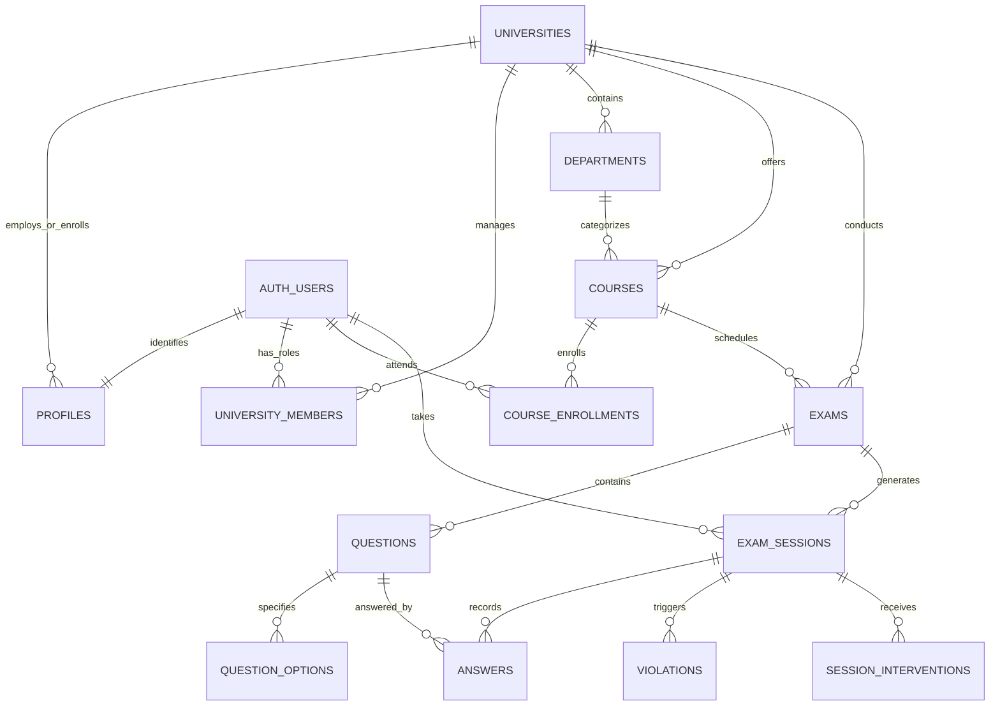

# AI ExamGuard — Database Architecture & Security Specification

## 1. Schema Design Philosophy

The database architecture is designed with the following core engineering principles:
1. **Multi-Tenant Isolation**: Every institutional resource strictly belongs to a `university_id`. Tenant isolation is enforced in PostgreSQL via Row-Level Security (RLS) policies.
2. **Denormalized Foreign Keys for RLS Efficiency**: Key relational entities (`courses`, `exams`, `exam_sessions`, `violations`) carry a direct `university_id` foreign key. This eliminates costly deep SQL `JOIN` operations inside RLS policy evaluation, keeping policy checks $O(1)$.
3. **Immutability of Audit & Violation Logs**: Records in `violations` and `exam_audit_logs` are append-only. Students and invigilators cannot update or delete historic logs.
4. **Answer Key Protection**: Student answers and correct answer options are structured such that students can query question prompts and options without the `is_correct` column being readable by students.

---

## 2. Complete Entity-Relationship (ER) Diagram



---

## 3. Data Dictionary & Table Definitions

### 3.1. `universities` (Tenants)
Represents educational institutions or certification organizations.

| Column | Type | Constraints | Description |
|---|---|---|---|
| `id` | `UUID` | `PRIMARY KEY, DEFAULT gen_random_uuid()` | Unique university ID |
| `name` | `TEXT` | `NOT NULL` | Full university name (e.g. Stanford University) |
| `slug` | `TEXT` | `UNIQUE, NOT NULL` | URL-safe identifier (e.g. `stanford`) |
| `domain` | `TEXT` | `NULLABLE` | Institutional email domain (e.g. `stanford.edu`) |
| `logo_url` | `TEXT` | `NULLABLE` | Institutional brand logo URL |
| `settings` | `JSONB` | `DEFAULT '{}'` | Institutional config (allowed models, proctoring defaults) |
| `created_at`| `TIMESTAMPTZ` | `DEFAULT now(), NOT NULL` | Timestamp created |

### 3.2. `profiles`
User metadata linked directly to Supabase `auth.users`.

| Column | Type | Constraints | Description |
|---|---|---|---|
| `id` | `UUID` | `PRIMARY KEY, REFERENCES auth.users(id) ON DELETE CASCADE` | Matches auth.users.id |
| `email` | `TEXT` | `NOT NULL` | User email address |
| `full_name` | `TEXT` | `NOT NULL` | Full display name |
| `avatar_url`| `TEXT` | `NULLABLE` | Profile picture URL |
| `created_at`| `TIMESTAMPTZ` | `DEFAULT now(), NOT NULL` | Creation timestamp |
| `updated_at`| `TIMESTAMPTZ` | `DEFAULT now(), NOT NULL` | Last updated timestamp |

### 3.3. `university_members`
User role mapping within a specific university.

| Column | Type | Constraints | Description |
|---|---|---|---|
| `university_id` | `UUID` | `REFERENCES universities(id) ON DELETE CASCADE` | University FK |
| `user_id` | `UUID` | `REFERENCES auth.users(id) ON DELETE CASCADE` | User FK |
| `role` | `TEXT` | `CHECK (role IN ('admin', 'faculty', 'student', 'invigilator'))` | User permission role |
| `created_at` | `TIMESTAMPTZ` | `DEFAULT now(), NOT NULL` | Date joined |

*Composite Primary Key*: `(university_id, user_id)`

### 3.4. `departments`
Academic departments (e.g., Computer Science, Electrical Engineering).

| Column | Type | Constraints | Description |
|---|---|---|---|
| `id` | `UUID` | `PRIMARY KEY, DEFAULT gen_random_uuid()` | Department ID |
| `university_id` | `UUID` | `REFERENCES universities(id) ON DELETE CASCADE, NOT NULL` | University FK |
| `name` | `TEXT` | `NOT NULL` | Department name |
| `code` | `TEXT` | `NOT NULL` | Department code (e.g. `CS`) |
| `created_at` | `TIMESTAMPTZ` | `DEFAULT now(), NOT NULL` | Creation timestamp |

### 3.5. `courses`
Courses administered within departments.

| Column | Type | Constraints | Description |
|---|---|---|---|
| `id` | `UUID` | `PRIMARY KEY, DEFAULT gen_random_uuid()` | Course ID |
| `university_id` | `UUID` | `REFERENCES universities(id) ON DELETE CASCADE, NOT NULL` | University FK |
| `department_id` | `UUID` | `REFERENCES departments(id) ON DELETE SET NULL` | Department FK |
| `faculty_id` | `UUID` | `REFERENCES auth.users(id) ON DELETE RESTRICT, NOT NULL` | Primary Faculty FK |
| `name` | `TEXT` | `NOT NULL` | Course title (e.g. Data Structures) |
| `code` | `TEXT` | `NOT NULL` | Course catalog code (e.g. `CS-201`) |
| `semester` | `TEXT` | `NOT NULL` | Term (e.g. `Fall 2026`) |
| `created_at` | `TIMESTAMPTZ` | `DEFAULT now(), NOT NULL` | Creation timestamp |

### 3.6. `course_enrollments`
Student enrollment registry for courses.

| Column | Type | Constraints | Description |
|---|---|---|---|
| `course_id` | `UUID` | `REFERENCES courses(id) ON DELETE CASCADE` | Course FK |
| `student_id` | `UUID` | `REFERENCES auth.users(id) ON DELETE CASCADE` | Student FK |
| `enrolled_at` | `TIMESTAMPTZ` | `DEFAULT now(), NOT NULL` | Enrollment timestamp |

*Composite Primary Key*: `(course_id, student_id)`

### 3.7. `exams`
Examination definitions.

| Column | Type | Constraints | Description |
|---|---|---|---|
| `id` | `UUID` | `PRIMARY KEY, DEFAULT gen_random_uuid()` | Exam ID |
| `course_id` | `UUID` | `REFERENCES courses(id) ON DELETE CASCADE, NOT NULL` | Course FK |
| `university_id` | `UUID` | `REFERENCES universities(id) ON DELETE CASCADE, NOT NULL` | University FK |
| `created_by` | `UUID` | `REFERENCES auth.users(id), NOT NULL` | Faculty creator |
| `title` | `TEXT` | `NOT NULL` | Examination title |
| `description` | `TEXT` | `NULLABLE` | Exam instructions |
| `duration_minutes` | `INT` | `CHECK (duration_minutes > 0), NOT NULL` | Allocated duration in minutes |
| `start_time` | `TIMESTAMPTZ` | `NOT NULL` | Scheduled opening time |
| `end_time` | `TIMESTAMPTZ` | `NOT NULL` | Scheduled closing deadline |
| `status` | `TEXT` | `CHECK (status IN ('draft', 'published', 'active', 'completed', 'archived')), DEFAULT 'draft'` | Current lifecycle status |
| `settings` | `JSONB` | `DEFAULT '{"require_camera": true, "require_audio": true, "require_fullscreen": true, "max_violations_threshold": 10}'` | Proctoring configuration rules |
| `total_points` | `INT` | `DEFAULT 100, NOT NULL` | Total grading points |
| `created_at` | `TIMESTAMPTZ` | `DEFAULT now(), NOT NULL` | Creation timestamp |

### 3.8. `questions`
Questions linked to an exam or question bank.

| Column | Type | Constraints | Description |
|---|---|---|---|
| `id` | `UUID` | `PRIMARY KEY, DEFAULT gen_random_uuid()` | Question ID |
| `exam_id` | `UUID` | `REFERENCES exams(id) ON DELETE CASCADE, NOT NULL` | Exam FK |
| `order_index` | `INT` | `NOT NULL` | Display sequence |
| `type` | `TEXT` | `CHECK (type IN ('mcq', 'multiple_choice', 'true_false', 'short_answer', 'essay'))` | Question type |
| `prompt` | `TEXT` | `NOT NULL` | Rich text or Markdown question body |
| `points` | `INT` | `DEFAULT 1, CHECK (points >= 0)` | Allocated point value |
| `explanation` | `TEXT` | `NULLABLE` | Post-exam solution explanation |
| `created_at` | `TIMESTAMPTZ` | `DEFAULT now(), NOT NULL` | Creation timestamp |

### 3.9. `question_options`
Options for multiple-choice and true/false questions.

| Column | Type | Constraints | Description |
|---|---|---|---|
| `id` | `UUID` | `PRIMARY KEY, DEFAULT gen_random_uuid()` | Option ID |
| `question_id` | `UUID` | `REFERENCES questions(id) ON DELETE CASCADE, NOT NULL` | Question FK |
| `label` | `TEXT` | `NOT NULL` | Choice identifier (e.g. `A`, `B`, `C`) |
| `content` | `TEXT` | `NOT NULL` | Choice description |
| `is_correct` | `BOOLEAN` | `DEFAULT false, NOT NULL` | Correct answer flag (Restricted to Faculty/Admin) |

### 3.10. `exam_sessions`
Student exam attempt instances.

| Column | Type | Constraints | Description |
|---|---|---|---|
| `id` | `UUID` | `PRIMARY KEY, DEFAULT gen_random_uuid()` | Session attempt ID |
| `exam_id` | `UUID` | `REFERENCES exams(id) ON DELETE CASCADE, NOT NULL` | Exam FK |
| `student_id` | `UUID` | `REFERENCES auth.users(id) ON DELETE CASCADE, NOT NULL` | Student FK |
| `university_id` | `UUID` | `REFERENCES universities(id) ON DELETE CASCADE, NOT NULL` | University FK |
| `status` | `TEXT` | `CHECK (status IN ('not_started', 'in_progress', 'submitted', 'terminated', 'reviewed')), DEFAULT 'not_started'` | Session state |
| `started_at` | `TIMESTAMPTZ` | `NULLABLE` | When candidate began |
| `submitted_at` | `TIMESTAMPTZ` | `NULLABLE` | When candidate finished |
| `score` | `DECIMAL(5,2)` | `NULLABLE` | Final grade achieved |
| `trust_score` | `DECIMAL(5,2)` | `DEFAULT 100.00, CHECK (trust_score >= 0.00 AND trust_score <= 100.00)` | Dynamic integrity confidence score |
| `hardware_status`| `JSONB` | `DEFAULT '{"camera": true, "microphone": true, "fullscreen": true}'` | Pre-flight check results |
| `created_at` | `TIMESTAMPTZ` | `DEFAULT now(), NOT NULL` | Created timestamp |

*Unique Constraint*: `UNIQUE (exam_id, student_id)` — One attempt per student per exam.

### 3.11. `answers`
Individual answers recorded during an exam attempt.

| Column | Type | Constraints | Description |
|---|---|---|---|
| `id` | `UUID` | `PRIMARY KEY, DEFAULT gen_random_uuid()` | Answer ID |
| `exam_session_id`| `UUID` | `REFERENCES exam_sessions(id) ON DELETE CASCADE, NOT NULL` | Session FK |
| `question_id` | `UUID` | `REFERENCES questions(id) ON DELETE CASCADE, NOT NULL` | Question FK |
| `response_text` | `TEXT` | `NULLABLE` | Written response for short answer / essay |
| `selected_option_id`| `UUID` | `REFERENCES question_options(id) ON DELETE SET NULL` | Selected MCQ option |
| `is_graded` | `BOOLEAN` | `DEFAULT false, NOT NULL` | Grading status |
| `points_awarded` | `DECIMAL(5,2)` | `NULLABLE` | Points earned |
| `feedback` | `TEXT` | `NULLABLE` | Grader feedback |
| `updated_at` | `TIMESTAMPTZ` | `DEFAULT now(), NOT NULL` | Last response timestamp |

### 3.12. `violations`
Explainable proctoring events generated during an exam session.

| Column | Type | Constraints | Description |
|---|---|---|---|
| `id` | `UUID` | `PRIMARY KEY, DEFAULT gen_random_uuid()` | Violation ID |
| `exam_session_id`| `UUID` | `REFERENCES exam_sessions(id) ON DELETE CASCADE, NOT NULL` | Session FK |
| `university_id` | `UUID` | `REFERENCES universities(id) ON DELETE CASCADE, NOT NULL` | University FK |
| `type` | `TEXT` | `CHECK (type IN ('NO_FACE', 'MULTIPLE_FACES', 'FACE_OCCLUDED', 'TAB_SWITCH', 'FULLSCREEN_EXIT', 'WINDOW_BLUR', 'AUDIO_ANOMALY', 'CLIPBOARD_PASTE', 'RIGHT_CLICK', 'DEVTOOLS_OPEN'))` | Event category |
| `severity` | `TEXT` | `CHECK (severity IN ('low', 'medium', 'high', 'critical')), NOT NULL` | Impact level |
| `details` | `JSONB` | `DEFAULT '{}'` | Metadata (duration, confidence, face coordinates) |
| `evidence_url` | `TEXT` | `NULLABLE` | Snapshot storage path |
| `created_at` | `TIMESTAMPTZ` | `DEFAULT now(), NOT NULL` | Exact timestamp occurred |

### 3.13. `session_interventions`
Invigilator actions taken during live exam sessions.

| Column | Type | Constraints | Description |
|---|---|---|---|
| `id` | `UUID` | `PRIMARY KEY, DEFAULT gen_random_uuid()` | Action ID |
| `exam_session_id`| `UUID` | `REFERENCES exam_sessions(id) ON DELETE CASCADE, NOT NULL` | Session FK |
| `invigilator_id` | `UUID` | `REFERENCES auth.users(id), NOT NULL` | Invigilator who took action |
| `action_type` | `TEXT` | `CHECK (action_type IN ('WARNING_MESSAGE', 'CAMERA_CHECK_REQUEST', 'PAUSE_EXAM', 'TERMINATE_EXAM')), NOT NULL` | Intervention type |
| `message` | `TEXT` | `NOT NULL` | Message displayed to student |
| `acknowledged` | `BOOLEAN` | `DEFAULT false, NOT NULL` | Has student dismissed warning |
| `created_at` | `TIMESTAMPTZ` | `DEFAULT now(), NOT NULL` | Action timestamp |

---

## 4. PostgreSQL Indexes for Query & RLS Performance

```sql
-- University Member lookups
CREATE INDEX idx_university_members_user ON public.university_members(user_id);
CREATE INDEX idx_university_members_lookup ON public.university_members(university_id, user_id, role);

-- Courses and Enrollments
CREATE INDEX idx_courses_uni ON public.courses(university_id);
CREATE INDEX idx_courses_faculty ON public.courses(faculty_id);
CREATE INDEX idx_course_enrollments_student ON public.course_enrollments(student_id);

-- Exams
CREATE INDEX idx_exams_uni_status ON public.exams(university_id, status);
CREATE INDEX idx_exams_course ON public.exams(course_id);
CREATE INDEX idx_exams_timing ON public.exams(start_time, end_time);

-- Questions & Options
CREATE INDEX idx_questions_exam ON public.questions(exam_id, order_index);
CREATE INDEX idx_question_options_q ON public.question_options(question_id);

-- Sessions & Violations (High Throughput)
CREATE INDEX idx_exam_sessions_exam ON public.exam_sessions(exam_id);
CREATE INDEX idx_exam_sessions_student ON public.exam_sessions(student_id);
CREATE INDEX idx_exam_sessions_uni_status ON public.exam_sessions(university_id, status);
CREATE INDEX idx_violations_session_time ON public.violations(exam_session_id, created_at DESC);
CREATE INDEX idx_violations_uni_severity ON public.violations(university_id, severity);
CREATE INDEX idx_answers_session ON public.answers(exam_session_id);
```

---

## 5. Row-Level Security (RLS) Strategy & Helper Functions

### 5.1. Security Definer Helper Schema

To prevent recursive RLS calls and achieve optimal plan caching in PostgreSQL, helper functions run in an isolated `private` schema with `SECURITY DEFINER` semantics:

```sql
CREATE SCHEMA IF NOT EXISTS private;

-- Check user role within an institution
CREATE OR REPLACE FUNCTION private.get_user_role(target_university_id UUID)
RETURNS TEXT
LANGUAGE sql
SECURITY DEFINER
STABLE
SET search_path = ''
AS $$
  SELECT role
  FROM public.university_members
  WHERE university_id = target_university_id
    AND user_id = auth.uid()
  LIMIT 1;
$$;

-- Check whether authenticated user is a member of an institution
CREATE OR REPLACE FUNCTION private.is_university_member(target_university_id UUID)
RETURNS BOOLEAN
LANGUAGE sql
SECURITY DEFINER
STABLE
SET search_path = ''
AS $$
  SELECT EXISTS (
    SELECT 1
    FROM public.university_members
    WHERE university_id = target_university_id
      AND user_id = auth.uid()
  );
$$;
```

### 5.2. Core RLS Policies Matrix

#### `universities`
- `SELECT`: Any authenticated member can read their own university details (`private.is_university_member(id) = true`).
- `UPDATE`: Only `admin` role (`private.get_user_role(id) = 'admin'`).

#### `courses`
- `SELECT`: University members can view courses.
- `INSERT/UPDATE/DELETE`: Faculty (for their own assigned courses) or Admin.

#### `exams`
- `SELECT`:
  - Faculty/Admin: Can read all exams in their university.
  - Invigilator: Can read `published` and `active` exams in their university.
  - Student: Can read `published`, `active`, and `completed` exams **only if enrolled in the parent course**.
- `INSERT/UPDATE/DELETE`: Only Faculty creator or Admin.

#### `questions` & `question_options`
- `SELECT`:
  - Faculty/Admin: Full access.
  - Student: Can view questions during an `in_progress` exam session.
  - **Answer Key Protection**: Standard student queries select `id, question_id, label, content`. A database VIEW or API projection ensures `is_correct` is omitted from student reads.

#### `exam_sessions`
- `SELECT`:
  - Student: Can only view their own exam sessions (`student_id = auth.uid()`).
  - Faculty/Invigilator/Admin: Can view all sessions for exams belonging to their university.
- `INSERT`: Student can create their own session when exam status is `active`.
- `UPDATE`: Student can update their own session status (e.g. submit) or server actions.

#### `violations`
- `INSERT`: Students can insert violation signals for their own active session (`exam_session_id IN (SELECT id FROM exam_sessions WHERE student_id = auth.uid())`).
- `SELECT`: Faculty, Invigilators, and Admins in the university. Students **cannot** read raw violation scores to prevent tampering.

#### `session_interventions`
- `SELECT`: Student can read warnings intended for their session (`exam_session_id IN (SELECT id FROM exam_sessions WHERE student_id = auth.uid())`); Invigilators/Faculty can read all.
- `INSERT`: Invigilators and Faculty can insert warnings.
- `UPDATE`: Student can update `acknowledged = true`.

---

## 6. Realtime Publication Setup

To enable instant live updates in the Invigilator Command Center:

```sql
-- Enable PostgreSQL Replication for proctoring tables
ALTER PUBLICATION supabase_realtime ADD TABLE public.violations;
ALTER PUBLICATION supabase_realtime ADD TABLE public.exam_sessions;
ALTER PUBLICATION supabase_realtime ADD TABLE public.session_interventions;
```

