# AI ExamGuard — 48-Hour Implementation Plan & Milestone Roadmap

## 1. Overview & Execution Rules

This document provides the definitive implementation plan for AI ExamGuard. Development strictly follows the sequential 15-phase methodology, requiring code inspection, linting, TypeScript compilation, and build verification after each phase before advancing.

---

## 2. Complete Frontend Route Architecture

```
ai-examguard/app/
│
├── (public)/                              # Unauthenticated marketing & product pages
│   ├── page.tsx                           # Institutional Landing Page (GSAP Hero, Live Demo preview, Stats)
│   ├── about/page.tsx                     # Product vision, security whitepaper & FERPA/GDPR compliance
│   └── contact/page.tsx                   # University sales & institutional onboarding inquiry
│
├── (auth)/                                # Authentication surface
│   ├── login/page.tsx                     # Unified role login (Admin, Faculty, Student, Invigilator)
│   ├── signup/page.tsx                    # Account creation with institutional role selection
│   ├── forgot-password/page.tsx           # Password reset request
│   └── reset-password/page.tsx            # New password setup
│
├── (dashboard)/                           # Authenticated role-specific dashboards (Shared Shell & Sidebar)
│   ├── layout.tsx                         # Persistent dark sidebar, breadcrumbs, tenant switcher, user profile
│   │
│   ├── admin/                             # University Administrator portal
│   │   ├── page.tsx                       # University overview, member statistics, audit activity
│   │   ├── university/page.tsx            # Institution configuration & proctoring rule defaults
│   │   ├── members/page.tsx               # Faculty, student, and invigilator directory & invite management
│   │   └── audit-logs/page.tsx            # System-wide compliance and security audit trail
│   │
│   ├── faculty/                           # Academic Faculty portal
│   │   ├── page.tsx                       # Faculty dashboard (active exams, enrolled students, pending reviews)
│   │   ├── courses/page.tsx               # Course list & course creation
│   │   ├── courses/[id]/page.tsx          # Course details, enrolled roster, assigned exams
│   │   ├── question-bank/page.tsx         # Centralized reusable question repository
│   │   ├── exams/page.tsx                 # Examination list with lifecycle status badges
│   │   ├── exams/new/page.tsx             # Exam authoring wizard (timing, settings, point allocation)
│   │   ├── exams/[id]/page.tsx            # Exam summary, candidate attempt analytics, trust distribution
│   │   ├── exams/[id]/edit/page.tsx       # Exam editor & question composer
│   │   └── exams/[id]/submissions/page.tsx# Student attempt list, manual grading queue, violation audit
│   │
│   ├── student/                           # Student examination portal
│   │   ├── page.tsx                       # Student dashboard (upcoming exams, active exams, past grades)
│   │   ├── exams/page.tsx                 # Enrolled course examinations
│   │   └── results/[sessionId]/page.tsx   # Certified grade, question breakdown, and proctoring review status
│   │
│   └── invigilator/                       # Real-Time Invigilator Command Center
│       ├── page.tsx                       # Live active exam room selector & aggregate candidate monitor
│       ├── monitor/[examId]/page.tsx      # Multi-candidate live grid, trust score gauge, realtime violation feed
│       └── session/[sessionId]/page.tsx   # In-depth candidate audit: timeline, snapshot evidence, intervention controls
│
├── exam/                                  # Focused Student Examination Sandbox (Isolated Layout)
│   ├── layout.tsx                         # Fullscreen, distraction-free layout (no global navigation/sidebar)
│   ├── [id]/
│   │   ├── preflight/page.tsx             # Hardware check: webcam permissions, audio meter, fullscreen gate
│   │   ├── take/page.tsx                  # Timed examination interface: question pager, local AI monitor, auto-save
│   │   └── submitted/page.tsx             # Post-exam submission confirmation & provisional score
│
└── api/                                   # RESTful endpoints & webhook integrations
    ├── auth/callback/route.ts             # Supabase OAuth/magic link callback
    ├── violations/route.ts                # Anomaly event ingestion & trust score calculation
    ├── exams/[id]/export/route.ts         # CSV / JSON gradebook and audit export
    └── webhooks/route.ts                  # LMS / SIS grade sync webhook receiver
```

---

## 3. Reusable UI Component System

To ensure a cohesive, accessible, and high-contrast cybersecurity SaaS aesthetic, UI components are structured into modular domains:

```
components/
├── ui/                                    # Base shadcn primitives (CVA styled, Radix/Base UI foundation)
│   ├── button.tsx                         # Variants: default, secondary, outline, ghost, destructive, cyan-glow
│   ├── card.tsx                           # Elevated dark card container (#111B2D, border #243249)
│   ├── badge.tsx                          # Severity & status pills (low, medium, high, critical, active, draft)
│   ├── input.tsx                          # High-contrast form inputs with focus cyan rings
│   ├── label.tsx                          # Accessible form labels
│   ├── dialog.tsx                         # Modal dialogues (interventions, confirmation alerts)
│   ├── tabs.tsx                           # Accessible tabbed navigation
│   ├── table.tsx                          # Dense institutional data tables
│   ├── progress.tsx                       # Trust score gauges and exam progress bars
│   ├── dropdown-menu.tsx                  # User profile and row-action dropdowns
│   └── tooltip.tsx                        # Contextual tooltips for proctoring metrics
│
├── shared/                                # Cross-cutting application components
│   ├── navbar.tsx                         # Public top navigation with animated mobile menu
│   ├── footer.tsx                         # Institutional footer with compliance links
│   ├── sidebar.tsx                        # Role-aware collapsible dashboard sidebar
│   ├── user-nav.tsx                       # Authenticated profile pill with logout action
│   ├── stat-card.tsx                      # KPI card with trend indicator and sparklines
│   ├── trust-score-gauge.tsx              # Radial / linear color-coded trust score visualizer
│   └── empty-state.tsx                    # Polished empty list placeholders
│
├── landing/                               # Public website visual showcase
│   ├── hero.tsx                           # GSAP animated cybersecurity headline, glowing CTAs, live radar graphic
│   ├── feature-grid.tsx                   # Interactive breakdown of face, audio, and browser integrity engines
│   ├── architecture-section.tsx           # Visual comparison of local Edge AI vs. cloud streaming
│   ├── stats-banner.tsx                   # Numerical counters for institutional credibility
│   └── cta-section.tsx                    # University demo booking callout
│
├── monitoring/                            # Edge AI proctoring client components
│   ├── camera-preview.tsx                 # Live candidate webcam feed with bounding box overlay
│   ├── audio-meter.tsx                    # Real-time Web Audio decibel visualizer bar
│   ├── browser-guard.tsx                  # Invisible event listener binding fullscreen and visibility events
│   └── preflight-modal.tsx                # Multi-step hardware verification wizard before exam launch
│
└── invigilator/                           # Invigilator command center components
    ├── candidate-tile.tsx                 # Real-time candidate card in the live proctoring grid
    ├── live-violation-feed.tsx            # Animated event feed subscribed to Supabase Realtime
    ├── candidate-timeline.tsx             # Interactive chronological scrubbing timeline of violations
    └── intervention-dialog.tsx            # Modal for sending warnings or terminating exams
```

---

## 4. 48-Hour Development Milestones & Phase Schedule

```mermaid
gantt
    title 48-Hour Sprint Schedule (AI ExamGuard MVP)
    dateFormat HH:mm
    axisFormat %H:%M

    section Foundation
    Phase 0 Architecture & Planning     :done, p0, 00:00, 2h
    Phase 1 Project Foundation          :active, p1, after p0, 2h
    Phase 2 Database & Security         :p2, after p1, 2h
    Phase 3 Auth & Role Management      :p3, after p2, 2.5h

    section Core SaaS
    Phase 4 Design System & Website     :p4, after p3, 3h
    Phase 5 Role-Specific Dashboards    :p5, after p4, 3h
    Phase 6 Examination Engine          :p6, after p5, 3h
    Phase 7 Student Exam Workflow       :p7, after p6, 3h

    section AI & Integrity
    Phase 8 AI Camera Monitoring        :p8, after p7, 2.5h
    Phase 9 Audio & Browser Monitoring  :p9, after p8, 2h
    Phase 10 Event Intelligence & Risk  :p10, after p9, 2h
    Phase 11 Invigilator Command Center :p11, after p10, 3h

    section Polish & Delivery
    Phase 12 Reports & Analytics        :p12, after p11, 2h
    Phase 13 Animation & UX Polish      :p13, after p12, 2h
    Phase 14 Testing & Security Audit   :p14, after p13, 2h
    Phase 15 Deployment & Demonstration :p15, after p14, 1h
```



### Detailed Phase Specifications

#### PHASE 0: Inspect and Plan (Current Milestone)
- **Deliverables**: Complete workspace audit, technology stack evaluation, architectural blueprints, database schema design, API definitions, security specifications, test strategy, and documentation suite in `docs/`.
- **Exit Gate**: Plan submitted and awaiting user approval.

#### PHASE 1: Project Foundation
- **Deliverables**: Typography configuration (`Inter`, `Space Grotesk`, `JetBrains Mono`), dark cybersecurity color system in `globals.css`, complete directory structure, Supabase middleware session refresher, admin client, core TypeScript definitions in `types/database.ts` and `types/index.ts`, and initial shadcn primitives.
- **Exit Gate**: `npm run build` succeeds with zero TypeScript or linting errors.

#### PHASE 2: Database and Security
- **Deliverables**: Execution of PostgreSQL migrations in Supabase, table creation, foreign key constraints, performance indexes, Security Definer helper functions, Row-Level Security policies for all four roles, and Realtime publication setup.
- **Exit Gate**: Verified database connection, policy enforcement, and seed data initialization.

#### PHASE 3: Authentication and Role Management
- **Deliverables**: Login and signup pages, role-based dashboard redirection, server actions for sign-in/sign-up, profile creation triggers, and session persistence in HTTP-only cookies.
- **Exit Gate**: Verified multi-role authentication flow (Admin, Faculty, Student, Invigilator) with route protection.

#### PHASE 4: Global Design System and Website
- **Deliverables**: Institutional landing page featuring high-impact GSAP hero animation, interactive feature breakdowns, compliance overview, responsive navigation, and cybersecurity theme integration.
- **Exit Gate**: High-converting public presence, responsive on all devices, fully accessible.

#### PHASE 5: Role-Specific Dashboards
- **Deliverables**: Authenticated layout shell with persistent dark sidebar, topbar breadcrumbs, and initial overview views for University Admin, Faculty, Student, and Invigilator.
- **Exit Gate**: All 4 role dashboards render appropriate statistical cards, navigational links, and empty states.

#### PHASE 6: Examination Engine
- **Deliverables**: Exam authoring wizard for faculty, question bank management, MCQ/essay question creator, exam configuration settings (duration, dates, proctoring toggles), and publication state transitions.
- **Exit Gate**: Faculty can create, edit, and publish complete multi-question exams.

#### PHASE 7: Student Examination Workflow
- **Deliverables**: Student exam lobby, hardware pre-flight verification wizard (camera, microphone, fullscreen check), timed exam interface with navigation pager, local answer auto-save, and server-side submission.
- **Exit Gate**: Enrolled student can launch, take, and submit an exam with answers persisted in the database.

#### PHASE 8: AI Camera Monitoring
- **Deliverables**: Client-side `@mediapipe/tasks-vision` `FaceDetector` integration, camera feed rendering with facial bounding boxes, 5 FPS throttled evaluation, detection of face absence and multiple faces.
- **Exit Gate**: Real-time detection verified on webcam with immediate anomaly state updates.

#### PHASE 9: Audio and Browser Monitoring
- **Deliverables**: Web Audio API decibel/acoustic anomaly detector, Page Visibility API listener (`visibilitychange`), Fullscreen change listener (`fullscreenchange`), and clipboard event blocking.
- **Exit Gate**: System detects and logs tab switches, fullscreen exit, and loud vocal speech.

#### PHASE 10: Event Intelligence and Risk Engine
- **Deliverables**: Anomaly ingestion API (`POST /api/violations`), batch debouncer, dynamic trust score calculation, event deduplication, and severity weighting.
- **Exit Gate**: Violations update `exam_sessions.trust_score` and record timestamped evidence.

#### PHASE 11: Invigilator Command Center
- **Deliverables**: Multi-candidate live monitoring grid, real-time violation stream via Supabase Realtime, candidate detail view with scrubbing timeline, and warning/intervention modals.
- **Exit Gate**: Invigilator observes live candidate tiles, receives instant violation alerts, and can issue candidate warnings.

#### PHASE 12: Reports and Analytics
- **Deliverables**: Exam summary reports, candidate integrity score distributions, Recharts visualizations, and CSV gradebook export.
- **Exit Gate**: Faculty can view and export comprehensive post-exam integrity reports.

#### PHASE 13: Animation and UX Polish
- **Deliverables**: GSAP scroll animations, Motion page transitions, dialog spring physics, loading skeletons, and `prefers-reduced-motion` compliance.
- **Exit Gate**: Premium SaaS feel with buttery smooth interactions and zero UI jank.

#### PHASE 14: Testing, Debugging, and Security Audit
- **Deliverables**: Comprehensive test run (`npm run lint`, `npx tsc --noEmit`, `npm run build`), answer-key leakage verification in browser DevTools, RLS role isolation audit, and edge-case bug fixes.
- **Exit Gate**: Zero build errors, zero type issues, zero security regressions.

#### PHASE 15: Deployment and Demonstration
- **Deliverables**: Production deployment on Vercel, verification of live environment variables, demo data seeding (sample university, courses, published exam, demo student account), and project README walkthrough.
- **Exit Gate**: Live production deployment URL verified and ready for demonstration.

---

## 5. Risk Register & Mitigation Strategy

| Risk | Impact | Mitigation Strategy |
|---|---|---|
| **MediaPipe WASM loading failure** | High | Load WASM bundle from official CDN (`jsdelivr`); provide clear UI error state if client browser blocks WebAssembly. |
| **High GPU/CPU consumption during exam** | High | Cap face detection rate at 5 FPS (200ms interval). Release WebGL textures immediately. |
| **Momentary Wi-Fi disconnection** | Medium | Local `localStorage` answer caching with background sync queue and non-blocking retry indicator. |
| **Supabase Realtime rate limits** | Medium | Client-side 3–5 second debouncing of violation events before network dispatch. |
| **DevTools answer scraping** | Critical | Server never sends `is_correct` flags or solution text to student clients. All grading executed server-side. |
| **48-Hour Time Overrun** | High | Strict adherence to sequential phases. Reusable components prioritized over bespoke one-offs. Zero gold-plating. |

