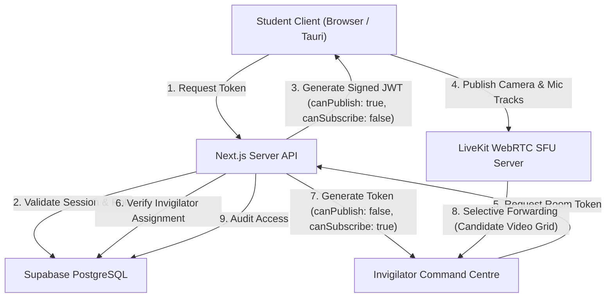

# AI ExamGuard — LiveKit WebRTC Surveillance Architecture

This document specifies the real-time media streaming architecture implemented in AI ExamGuard using LiveKit, WebRTC, and Selective Forwarding Units (SFUs).

---

## 1. Executive Architecture & SFU Topology

AI ExamGuard decouples examination UI and database interactions from high-throughput WebRTC media transport:
- **Web Interface:** Next.js 16 + React 19.
- **Database & State:** Supabase PostgreSQL with Row Level Security (RLS).
- **Surveillance Transport:** LiveKit WebRTC SFU (Selective Forwarding Unit).

---

## 2. Participant Role Permissions & Security Matrix

| Role | Room Permissions | Media Grants | Security Enforcement |
|---|---|---|---|
| **Student (Candidate)** | `roomJoin: true` | `canPublish: true` `canSubscribe: false` `canPublishSources: ['camera', 'microphone']` | **Strict Isolation:** Candidate is cryptographically prevented from subscribing to any other candidate's stream. |
| **Invigilator (Proctor)** | `roomJoin: true` | `canPublish: false` `canSubscribe: true` `canPublishData: true` | **Read-Only Surveillance:** Receives candidate streams without transmitting personal video. Can publish data channel announcements. |
| **Faculty / Admin** | `roomJoin: true` | `canPublish: false` `canSubscribe: true` | Can inspect any candidate in assigned institutional tenant. |

---

## 3. Bandwidth Optimization & Adaptive Simulcast

To allow an invigilator to monitor up to 50–100 students on a standard laptop:
1. **Low-Resolution Thumbnail Grid:**
   - Default grid video streams receive low-bandwidth spatial layers ($240\text{p} \times 180\text{p} \text{ at } 15\text{ FPS}$, $\approx 120\text{ kbps}$ per candidate).
2. **Dynamic High-Resolution Inspector:**
   - When the invigilator selects a candidate for inspection, LiveKit SFU automatically shifts that single participant's track to the high-quality layer ($720\text{p} \times 480\text{p} \text{ at } 30\text{ FPS}$, $\approx 800\text{ kbps}$).
3. **Bandwidth Savings:**
   - Reduces overall invigilator workstation downlink from $40\text{ Mbps}$ to $< 4.5\text{ Mbps}$ for a 30-candidate examination room.

---

## 4. Privacy & Recording Policies

- **Default Setting:** `LIVE VIDEO ONLY, NO CONTINUOUS RECORDING`.
- **Statutory Notice:** Candidates are shown a permanent green visual badge indicating *"Live Surveillance Active"*.
- **Permission Denial Handling:** If camera permissions are blocked by the OS/browser, pre-flight prevents exam entry until permissions are resolved.
- **Session Termination:** All WebRTC peer connections and media tracks are automatically destroyed upon examination submission.

