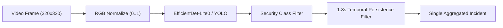

# AI ExamGuard — Mobile Phone & Electronic Device Detection

This document specifies the on-device object detection architecture, model performance benchmarks, temporal persistence filters, and false-positive prevention mechanisms.

---

## 1. Detection Pipeline Overview

---

## 2. Detected Security Classes

1. **`cell phone`:** Mobile smartphone devices held in hand, placed on desk, or positioned near the screen.
2. **`laptop`:** Secondary computing laptops or secondary active displays.
3. **`book` / `notebook`:** Printed notes, textbooks, or unauthorized reference materials.
4. **`person`:** Secondary individuals entering the candidate's workspace.

---

## 3. Temporal Persistence & Incident Coalescing

- **Problem:** Single-frame object detectors often mistake hand gestures (resting chin on knuckles) or wallets for mobile phones for 1–2 frames.
- **Solution:** AI ExamGuard requires $\ge 1.8\text{ seconds}$ of contiguous, sustained phone detection before generating an alert.
- **Incident Coalescing:** If a candidate keeps a phone visible for 15 seconds, the engine generates **exactly one** `PHONE_DETECTED` incident rather than 45 separate alerts.
- **Cooldown Window:** A 25-second cooldown ensures repeat notifications are strictly separated.

