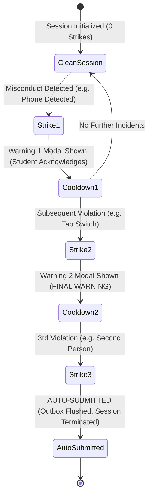

# AI ExamGuard — Three-Strike Policy & Automated Submission Architecture

This document specifies the operational design, database rules, cooldown mechanisms, and student communication flow for AI ExamGuard's configurable warning and auto-submission engine.

---

## 1. Architectural Philosophy

Online examination platforms traditionally suffer from two opposing flaws:
1. **Unforgiving False Positives:** Immediately terminating or penalizing a student for an inadvertent movement, background noise, or network flicker.
2. **Impunity:** Silently recording alerts in an invigilator log while allowing unauthorized aids (phones, second screens, whispered answers) to go unchallenged in real time.

AI ExamGuard implements an **escalating, server-authoritative Three-Strike Policy**:
* Real-time audible and visual intervention at Strike 1 and Strike 2.
* Clear statutory notice explaining the exact violation and required remedy.
* Immutable auto-submission on Strike 3 under faculty-configured institutional policies.
* Complete exemption of technical failures (hardware disconnects, network drops).

---

## 2. Strike Escalation Workflow

### Strike Progression Details:

| Strike Level | Classification | Student UI Dialogue | Consequence |
|---|---|---|---|
| **Strike 1** | **Advisory Notice** | *"Warning 1 of 3 — Examination Integrity Notice"* Describes the detected behavior and directs the candidate to maintain exam compliance. | Logged to `session_warning_events`. Requires student acknowledgment to resume. |
| **Strike 2** | **Final Warning** | *"Warning 2 of 3 — Final Warning"* Explicit statutory notice that another qualifying policy violation will automatically terminate and submit the exam. | Logged to `session_warning_events`. Visual status meter turns orange/red. |
| **Strike 3** | **Policy Termination** | *"Warning 3 of 3 — Examination Automatically Submitted"* Explains that the maximum warning threshold has been reached. Informs the candidate that all answers have been saved and forwarded for review. | Server transitions `exam_sessions.status` to `submitted`, sets `auto_submitted = true`, flushes answers, and locks the session. |

---

## 3. Cooldown & Debounce Protection

To prevent a single continuous incident (e.g., someone walking behind the student for 4 seconds) from instantly generating 3 consecutive strikes, the `WarningPolicyEngine` enforces a **configurable cooldown period**:
* Default Cooldown: **20 seconds** (configurable between 10s and 60s per exam).
* If an incident is sustained, only ONE strike is registered within the cooldown window.
* Subsequent strikes require the cooldown window to elapse.

---

## 4. Technical Incident Exemption Matrix

The following incidents are strictly classified as **Technical / Hardware Events** and **NEVER count as strikes**:
* `CAMERA_DISCONNECTED` (e.g., USB cable pulled, camera glitch)
* `CAMERA_PERMISSION_DENIED`
* `MICROPHONE_DISCONNECTED`
* `MICROPHONE_PERMISSION_DENIED`
* `OBJECT_DETECTION_UNAVAILABLE`
* `GAZE_ESTIMATION_UNAVAILABLE`
* `SESSION_CONNECTION_INTERRUPTED`
* `OFFLINE_SYNC_SAVED`

These events are routed to the Invigilator Dashboard as hardware status notifications, allowing proctors to assist the student rather than falsely disqualifying them.

---

## 5. Database Schema & Audit Trail

The warning system is backed by three tables with full Row-Level Security (RLS):

1. **`exam_policies`**:
   - `max_warnings`: Default 3 (range 1–5).
   - `warning_cooldown_seconds`: Default 20.
   - `auto_submission_enabled`: Boolean toggle.
   - Toggles per feature: `phone_detection_strike`, `additional_person_strike`, `multiple_faces_strike`, `tab_switch_strike`, `fullscreen_required`, `audio_vad_strike`, `gaze_deviation_strike`.
2. **`session_warning_events`**:
   - Immutable audit log of every strike issued with `strike_number`, `event_type`, `reason`, `confidence`, and `timestamp`.
3. **`exam_submission_audit`**:
   - Stores submission provenance (`submission_type`: `manual`, `auto_timeout`, `auto_policy_strike`).

---

## 6. Faculty Policy Customization

Faculty and Exam Administrators can configure policies for each individual exam via the **Exam Policy Configuration** page (`/faculty/exams/[examId]/policy`):
* Change maximum allowable warnings (1 to 5).
* Adjust cooldown duration.
* Selectively toggle individual triggers (e.g., allow speech activity for oral exams, or disable fullscreen requirements for open-book tests).
